<div align="center">
  
  <h1>DilliFlow</h1>
  <p><strong>Move smarter. Ride calmer.</strong></p>
  <p>Know your bus options. See the demand behind them. Follow vehicles when live data is available.</p>
</div>

<p align="center">
  
  
  
  
  
</p>

**DilliFlow is a bus journey planner and service-intelligence tool for Delhi.** It was built for the Transport Stack Hackathon 2026, Delhi Transport Stack — Problem 2: Crowdedness-Aware Journey Planner.

A passenger can search a journey, compare faster and more comfortable options, inspect historical demand on the route, and see live vehicle positions when the feed is available. A separate operator workspace turns the same underlying data into route rankings, stop-to-stop investigations and service-review suggestions.

The project brings together three different sources, each with a different job:

- **Static GTFS** tells DilliFlow which routes, stops and scheduled trips exist.
- **October 2026 e-ticket records** provide a historical sample of passenger journeys and demand patterns.
- **GTFS-Realtime VehiclePositions** provides reported vehicle locations and timestamps.

> **One important distinction:** ticket demand is not a live passenger count, and a GPS point does not tell us how full a bus is. DilliFlow keeps those signals separate and labels estimates and capacity assumptions rather than presenting them as measured occupancy.

### What is in the project

| Passenger side | Operator side |
|---|---|
| Journey search and transfer options | Route and direction demand rankings |
| Fastest vs. More comfortable comparison | Stop-to-stop segment investigations |
| Historical crowding indicators | Service-review recommendations |
| Live bus map and eligible journey tracking | Route capacity profile management |
| Routes, stops and methodology pages | Data coverage and quality indicators |

### Dataset snapshot

The local ingestion run processed **2,559,899 ticket records** alongside the supplied Delhi GTFS feed. It matched **98.23%** of ticket rows to a GTFS route. Boarding and alighting stop-name matches were **81.00%** and **81.65%** respectively. These are results from the supplied October 2026 files, not live network totals.

---

## Contents

- [Application screenshots](#application-screenshots)
- [How DilliFlow works](#how-dilliflow-works)
- [Core features](#core-features)
- [Technology stack](#technology-stack)
- [System architecture](#system-architecture)
- [Data pipeline](#data-pipeline)
- [Data model](#data-model)
- [Crowding and capacity methodology](#crowding-and-capacity-methodology)
- [Live vehicle tracking and ETA](#live-vehicle-tracking-and-eta)
- [REST API](#rest-api)
- [Security and configuration](#security-and-configuration)
- [Local setup](#local-setup)
- [Run and verify](#run-and-verify)
- [Deployment](#github-and-deployment)
- [Data quality and limitations](#data-quality-assumptions-and-limitations)
- [Project structure](#project-structure)
- [Acknowledgements](#acknowledgements)

## How DilliFlow works

The commuter experience starts with the timetable, not the live feed. DilliFlow finds valid scheduled journeys from GTFS, then adds historical demand and capacity context to each leg. For eligible journeys happening today, it can also look for a route-matched vehicle in the latest GPS snapshot. If live evidence is missing or does not support an ETA, the app should say so instead of manufacturing one.

The operator workspace uses historical ticket aggregates and scheduled departures to highlight routes and segments worth investigating. Recommendations are prompts for human review; they do not dispatch buses or change schedules.

## Product screenshots

These are screenshots from the running application. They show the main passenger and operator workflows; live vehicle counts and data values are snapshots and will change.

### 1. Passenger journey planner

Passengers select origin, destination, date and departure time. Journey options can be compared using the **More comfortable** and **Fastest** views.

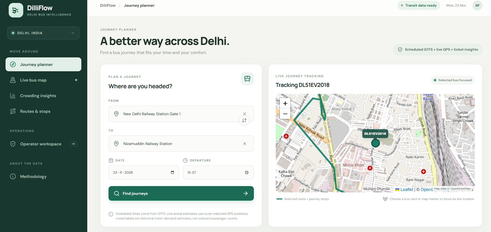

### 2. Journey options, bus capacity reference and historical load

Each journey leg exposes a seating/standing reference, estimated availability where a demand estimate exists, and the basis of the displayed values.

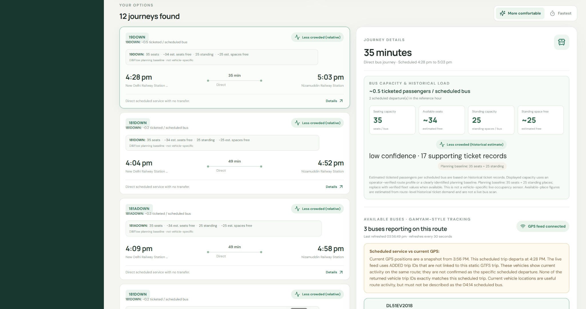

### 3. Selected-bus tracking and stop timeline

A route-matched vehicle can be selected from the journey details. The passenger can inspect GPS freshness, inferred route progress, arrival estimates where speed/direction evidence supports them, and the stop-by-stop timeline.

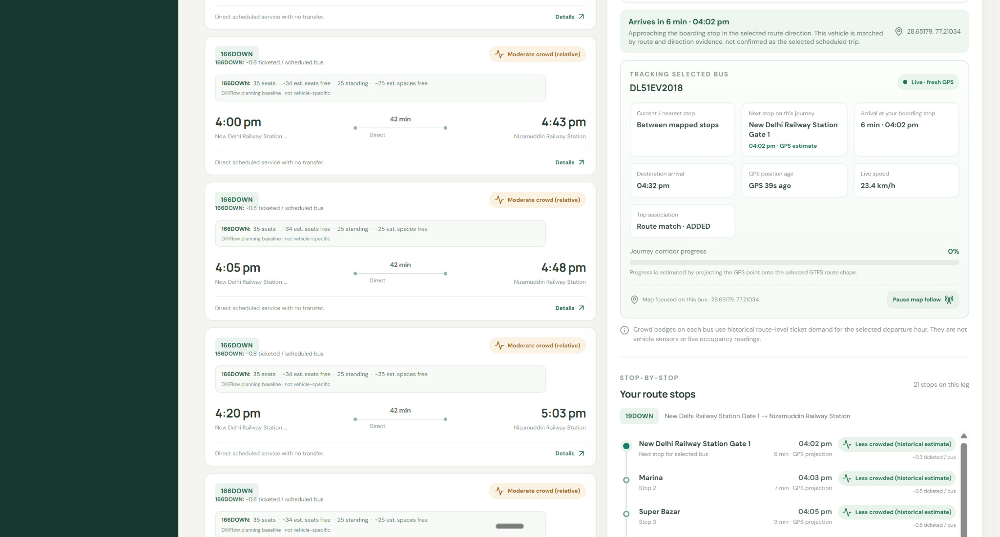

### 4. Live bus map

The map plots returned vehicle positions and exposes freshness and vehicle details. Markers are live feed observations, not inferred passenger-load sensors.

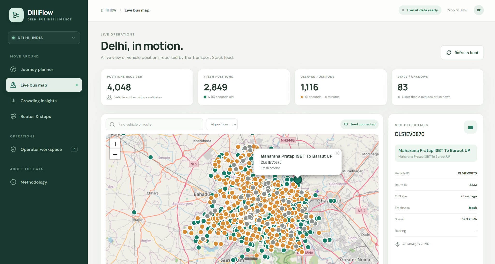

### 5. Crowding insights

Historical ticket demand is summarised across the network, including time-of-day patterns, route signals and ingestion data-quality indicators.

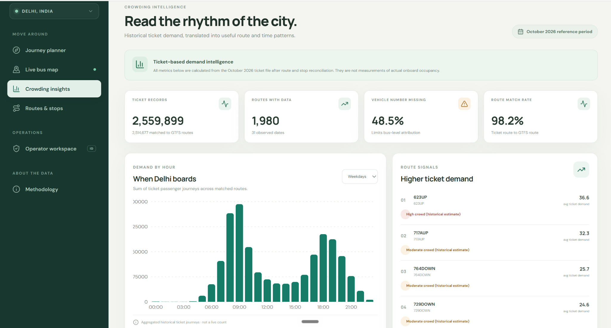

### 6. Routes and stops directory

Passengers and researchers can search the static GTFS network, inspect representative stop patterns and view a route on the map.

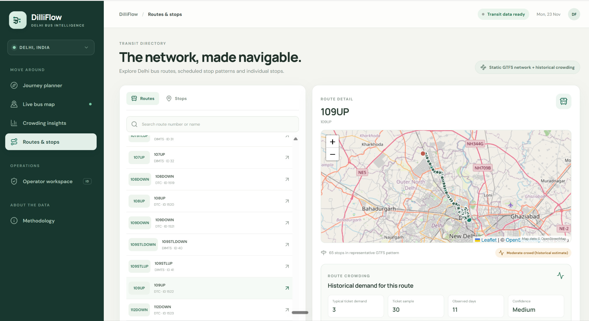

### 7. Stop-to-stop route intelligence

The route detail view exposes adjacent-stop historical demand estimates along the representative route pattern.

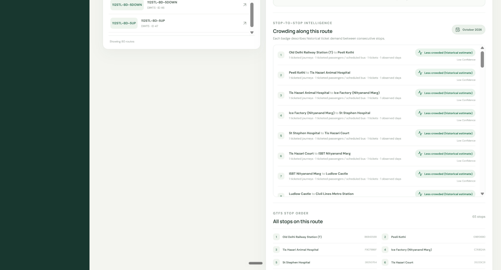

### 8. Stop detail

A selected stop shows its coordinates, GTFS identity and the routes/adjacent segments associated with the representative patterns.

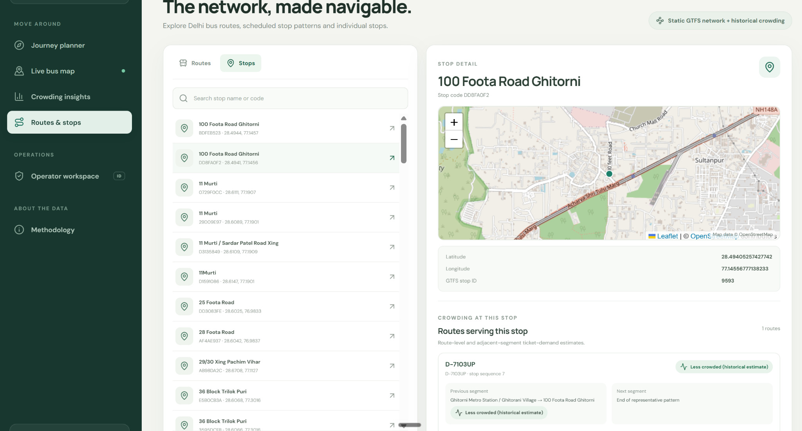

### 9. Operator intelligence overview

The protected operator workspace shows data quality, network demand, selected time/day filters and priority stretches for review.

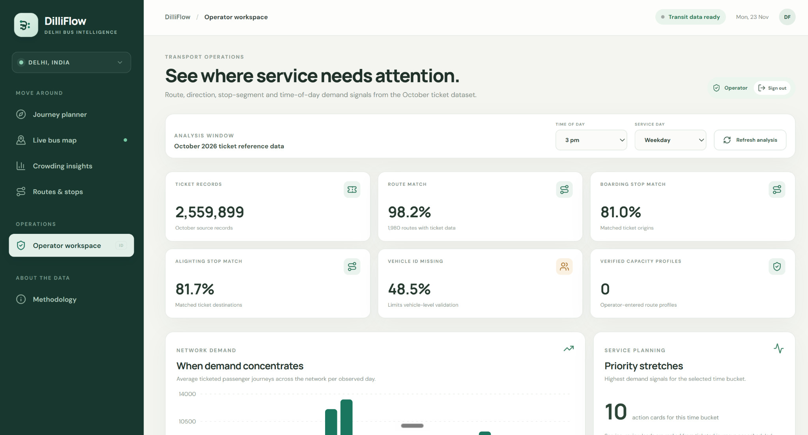

### 10. Operator service recommendations

Recommendations are ranked from ticketed demand, scheduled departures and any operator-verified capacity profiles. They request review and field validation rather than issuing automatic dispatch instructions.

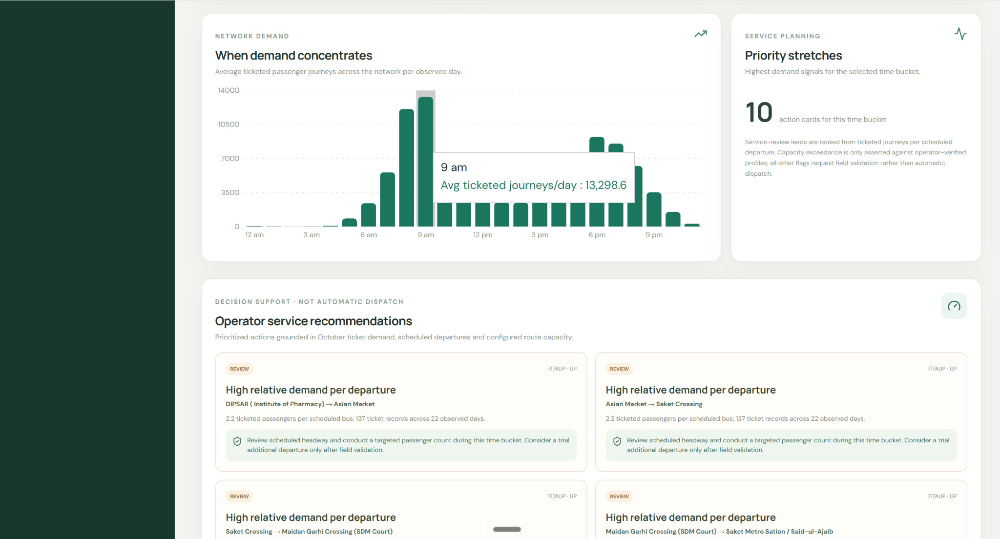

### 11. Route rankings and direction analysis

Route rankings compare historical demand per scheduled departure, observed ticket sample and service frequency. Direction labels use the representative GTFS trip pattern and are caveated where the ticket file itself is not direction-tagged.

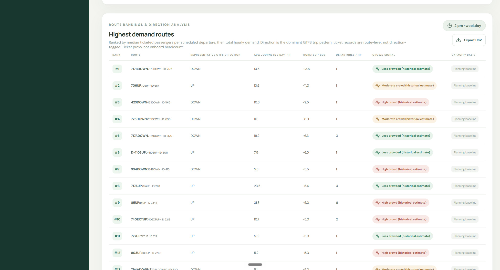

### 12. Overloaded-segment investigations

The operator can search stop-to-stop stretches and filter investigation priority to focus frequency reviews and field validation.

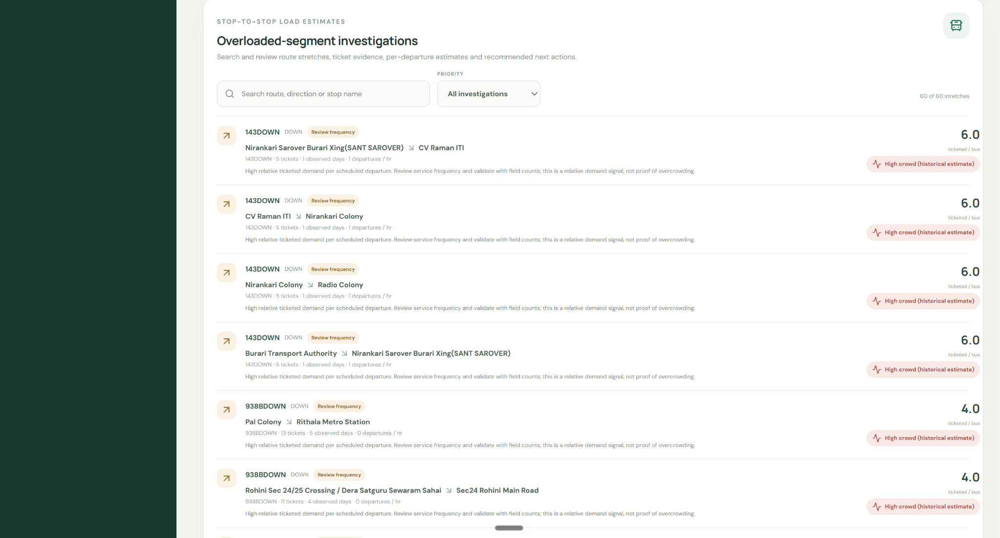

### 13. Methodology and source separation

The methodology page explains the roles of static GTFS, ticket records and GTFS-Realtime and distinguishes historical demand from current vehicle location.

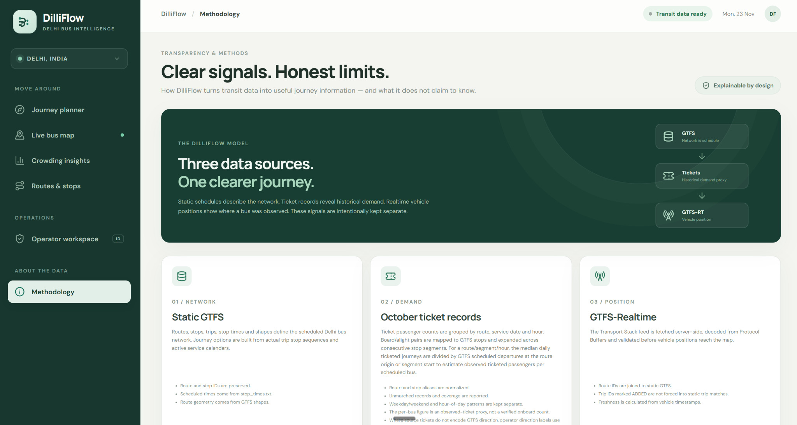

### 14. Data pipeline and workspace model

The application separates open commuter access from protected transport operations and describes the path from raw source files to the user-facing application.

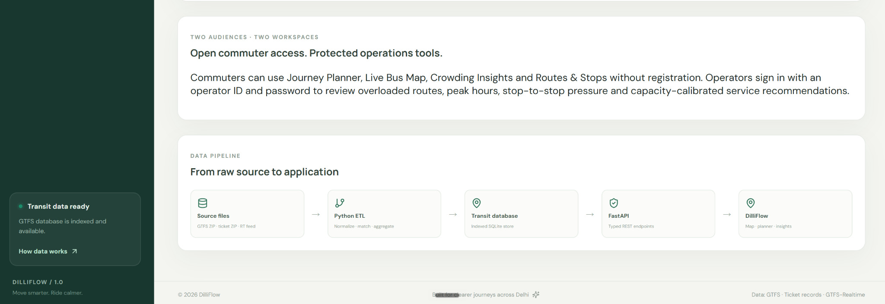

## Core features

### Public commuter workspace

| Area | Capabilities |
|---|---|
| Journey planner | Search between GTFS stops by date and departure time; direct and up-to-one-transfer journey options; scheduled journey duration; Fastest and More comfortable comparison |
| Capacity reference | Seat capacity, standing capacity, estimated available seats and estimated standing spaces for each route leg; route-specific verified profiles take precedence over the general planning baseline |
| Historical crowding | Relative low/moderate/high demand indication, supporting ticket sample, observed days and confidence where available |
| Live journey tracking | Route-matched live vehicle candidates for today's still-upcoming services; selectable bus cards and map markers; pause/resume map follow; vehicle freshness and stop timeline |
| Live bus map | Network-wide vehicle positions, freshness categories, search/filter controls and vehicle detail panel |
| Crowding insights | Ticket record volume, routes with ticket data, route matching, missing vehicle IDs, peak-hour patterns and higher-demand routes |
| Routes & stops | Searchable GTFS route and stop directories, route geometry, stop order and stop/route crowding context |
| Methodology | Source descriptions, ETL flow, demand interpretation, model assumptions and limitations |

### Protected operator workspace

- **Operator authentication** — operator ID/password login with signed, expiring bearer-token sessions.
- **Network demand analysis** — hourly passenger-journey trends split by weekday/weekend.
- **Route rankings** — ticket-derived demand, per-scheduled-departure proxy, scheduled departures, representative direction and capacity basis.
- **Overloaded-segment investigations** — searchable stop-to-stop priority stretches with ticket records, observed days, demand per bus, confidence and next action.
- **Operator service recommendations** — high-relative-demand frequency reviews; capacity-pressure investigations when a verified profile exists; recommended validation steps.
- **Capacity profile management** — create/update/delete operator-verified seat and standing capacity by GTFS route.
- **CSV export** — export route ranking data for offline review.
- **Data-quality indicators** — total source records, route match, boarding/alighting stop matches, missing vehicle number share and configured capacity profile count.

Recommendations are leads for service planning. They do not automatically change timetables, assign vehicles or dispatch additional buses.

## Technology stack

| Layer | Technology | Responsibility |
|---|---|---|
| Frontend | React 19, TypeScript 5.7, Vite 6 | Single-page commuter and operator UI |
| Routing/UI | React Router 7, Lucide React | Page navigation and icon system |
| Maps | Leaflet, React Leaflet, OpenStreetMap tiles | Route geometry, stops and live vehicle maps |
| Charts | Recharts | Historical demand and operator analytics |
| Backend | Python, FastAPI, Pydantic, Uvicorn | REST API, validation, authentication and service orchestration |
| Data processing | Python CSV/ZIP/SQLite, RapidFuzz | Streaming ticket ingestion, route/stop reconciliation and aggregates |
| Database | SQLite | Local GTFS tables, ticket aggregates, metadata and operator capacity profiles |
| Realtime | GTFS-Realtime Protobuf bindings, Requests | Server-side feed retrieval and VehiclePositions decoding |
| Configuration | python-dotenv | Backend environment configuration |
| Frontend hosting | Vercel | Static SPA build and route rewrites |
| Backend hosting | Persistent-volume Python service (e.g. Render) | FastAPI process, local SQLite file and server-side API secret |

## System architecture

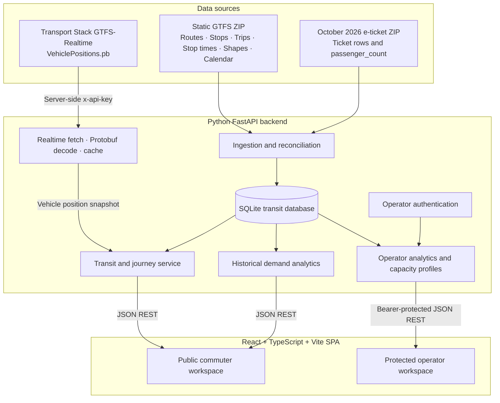

The browser never calls the Transport Stack feed directly and never receives `TRANSPORT_STACK_API_KEY`. The FastAPI service fetches and decodes the Protobuf response, caches vehicle positions and exposes only the resulting data fields to the frontend.

### Passenger journey flow

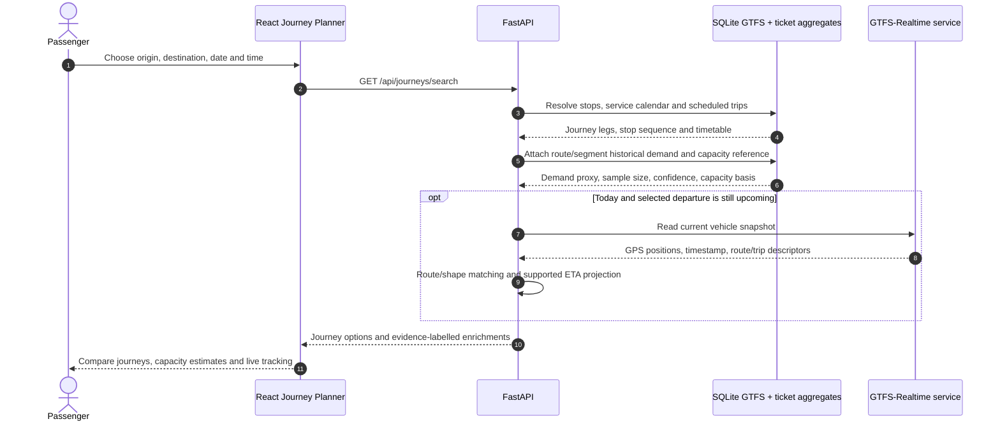

### Ticket ingestion flow

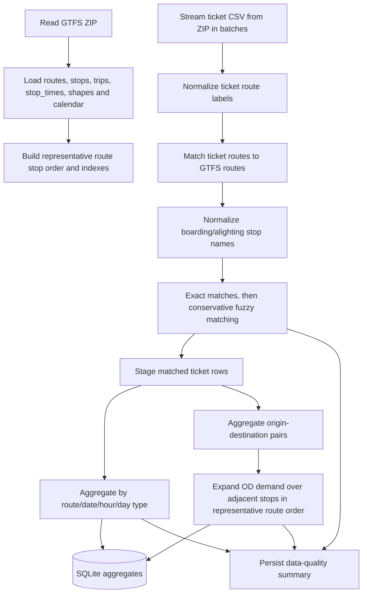

## Data pipeline

The pipeline is designed to keep the original timetable, ticket evidence and live GPS feed separate until the application needs to combine them for a specific view.


### Static GTFS ingestion

The loader reads the supplied GTFS archive and imports the network/timetable files used by the application:

- `routes.txt`
- `stops.txt`
- `trips.txt`
- `stop_times.txt`
- `shapes.txt`
- `calendar.txt` (when present in the source archive)

It creates route/stop lookup indexes and a representative route stop order used by route and segment analytics. A route can have multiple trips, directions and patterns; a representative route pattern is an analytical simplification and is identified as such in the UI and methodology.

### Ticket ingestion

The October ticket ZIP is streamed in batches. The process normalizes route labels, matches them to static GTFS routes, reconciles boarding/alighting stop names, stages ticket rows and creates the route-hour, origin-destination and stop-segment aggregates. It also writes matching, missingness and coverage metrics to `ingestion_meta`.

### Verified source-data snapshot

The completed local ingestion reported the following results for the supplied October 2026 archives:

| Metric | Result |
|---|---:|
| GTFS routes | 2,574 |
| GTFS stops | 6,862 |
| GTFS trips | 80,357 |
| GTFS stop-time rows | 2,737,136 |
| GTFS shape points | 965,607 |
| Ticket source records | 2,559,899 |
| Ticket records matched to a GTFS route | 2,514,677 (98.23%) |
| Ticket rows missing vehicle number | 1,242,167 (48.52%) |
| Boarding stop-name matches | 2,036,804 (81.00%) |
| Alighting stop-name matches | 2,053,270 (81.65%) |
| Route/date/hour aggregates | 412,970 |
| Origin/destination aggregate groups | 1,511,663 |
| Stop-segment aggregate rows | 3,411,416 |
| Ticket period | 1–31 October 2026 |

These values are tied to the supplied dataset snapshot. They are not real-time network totals, nor evidence that every passenger generated a row in the ticket sample.

## Data model

The SQLite store has three logical groups: static transit reference data, derived ticket-demand aggregates and application/operator metadata.

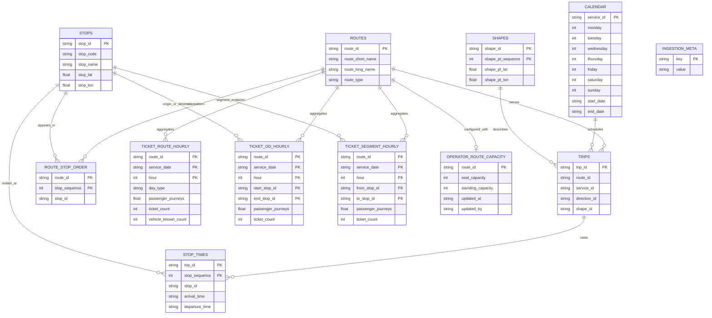

**Note:** The diagram shows the logical associations used by the application. Some aggregate tables use route/stop identifiers as analytical keys rather than enforcing every association as a SQLite foreign-key constraint.

### Table responsibilities

| Table | Purpose | Important fields / key |
|---|---|---|
| `routes` | Static GTFS route directory | `route_id`, short/long name, route type |
| `stops` | Static GTFS stop directory and map locations | `stop_id`, name, code, latitude, longitude |
| `trips` | Scheduled trip patterns | `trip_id`, `route_id`, `service_id`, `direction_id`, `shape_id` |
| `stop_times` | Ordered arrival/departure times for each trip | `(trip_id, stop_sequence)`, `stop_id`, arrival/departure |
| `shapes` | Ordered route geometry points | `(shape_id, shape_pt_sequence)`, coordinates |
| `calendar` | Weekly service activation dates | `service_id`, weekdays, start/end dates |
| `route_stop_order` | Representative route stop sequence for search/segment analytics | `(route_id, stop_sequence)`, `stop_id` |
| `ticket_route_hourly` | Ticket demand by route/date/hour/day class | `(route_id, service_date, hour)`, journeys, ticket counts |
| `ticket_od_hourly` | Ticket origin-destination demand | route/date/hour plus origin and destination stop IDs |
| `ticket_segment_hourly` | Estimated demand between consecutive stops | route/date/hour plus ordered stop pair |
| `operator_route_capacity` | Operator-entered verified route capacity profile | `route_id`, seat and standing capacities, audit fields |
| `ingestion_meta` | Source counts, ETL summary and build metadata | `key`, `value` |

Live GTFS-Realtime vehicle positions are fetched/cached by the backend and are not persisted as a passenger-occupancy table in this model.

## Crowding and capacity methodology

DilliFlow does not claim to measure the number of people physically standing inside a bus. The available ticket data supports a demand proxy; the capacity panel compares that proxy with a stated capacity reference.


### 1. Route-level historical demand

For a route, hour and day type (weekday/weekend), DilliFlow calculates the median daily ticketed passenger journeys across the matching observed dates. When a matching scheduled-departure denominator exists, it estimates ticketed journeys per scheduled bus:

\[
\text{Estimated ticketed journeys per scheduled bus} =
\frac{\text{Median daily ticketed journeys for route/hour/day type}}
{\text{GTFS scheduled departures at route origin in that hour}}
\]

### 2. Segment-level historical demand

For a stop-to-stop segment, matched ticket origin-destination journeys are expanded across consecutive stops in the representative route pattern. The segment estimate uses the median daily segment demand for that hour/day type divided by GTFS departures passing the segment origin in the hour.

### 3. Fallback behaviour

When an exact hour/segment sample is absent, the estimator can use a nearest available hour, a route-level or network reference, with confidence lowered and the estimate basis labelled. When no demand reference can be calculated, the capacity panel still shows the configured or planning-reference capacity as a nominal upper bound; it must not describe those places as observed empty seats.

### 4. Capacity reference for journey results

When an operator has entered a verified route profile, that route's configured seat and standing values are used. Otherwise, DilliFlow displays a clearly identified planning baseline:

- **35 seats per bus**
- **25 standing places per bus**

These are DilliFlow planning assumptions only. They are **not official DTC/fleet specifications** and are not a statement that every bus assigned to a route has that layout.

Where a demand proxy exists, estimated remaining places are computed against that reference. Where demand is unavailable, the interface shows nominal capacity upper bounds and labels the basis as capacity-only fallback. All seat/standing availability fields remain estimates. Seat/standing/crowded categories are only activated against an operator-verified route profile.

### 5. Confidence

The route estimator uses the supporting ticket sample and observed days to communicate confidence. Fallback estimates are marked lower confidence. Confidence is an indication of evidence coverage, not a statistical guarantee that the true load lies within a known error interval.

### 6. No invented expansion factor

DilliFlow does not multiply ticket records by an unsupported factor to claim total passengers. It reports observed ticketed journeys and derived relative demand only.

## Live vehicle tracking and ETA

- The backend requests the Transport Stack `VehiclePositions.pb` endpoint with the secret `x-api-key` header.
- Protocol Buffers are decoded server-side with `gtfs-realtime-bindings`.
- Vehicle positions are associated with static GTFS routes where route IDs match; a route-level match is not automatically an exact scheduled-trip match.
- The observed feed may use `ADDED` trip descriptors whose trip IDs do not match static scheduled GTFS trip IDs. DilliFlow does not force an invalid exact trip association.
- Vehicle freshness is derived from the source timestamp: **fresh ≤90 seconds**, **delayed >90 and ≤300 seconds**, **stale >300 seconds**, and **unknown** where timestamp information is missing. Future timestamps are treated as a data-quality condition.
- The journey planner enriches only today's still-upcoming scheduled departures with current GPS candidates. It does not invent live ETAs for past or future dates.
- A selected vehicle can be highlighted and followed on the journey map. Stop projections are inferred from GPS/route geometry and displayed as inferred progress.
- Downstream arrival estimates require usable direction and speed evidence. A vehicle may remain visible even when future-stop ETA cannot be supported.

**GPS location is not passenger occupancy.** The GTFS-Realtime feed does not provide a reliable live passenger count or live seat availability in this implementation.

## REST API

Local base URL: `http://127.0.0.1:8000`. Interactive OpenAPI documentation: `http://127.0.0.1:8000/docs`.

### System and network

| Method | Endpoint | Purpose |
|---|---|---|
| `GET` | `/` | API name, version and docs/health links |
| `GET` | `/api/health` | Database, feed and operator readiness |
| `GET` | `/api/meta` | GTFS counts and ticket ingestion summary |
| `GET` | `/api/routes?q=&limit=&offset=` | Search/list routes |
| `GET` | `/api/routes/{route_id}` | Route, representative stop pattern, geometry and crowding |
| `GET` | `/api/stops?q=&limit=&offset=` | Search/list stops |
| `GET` | `/api/stops/search?q=&limit=` | Stop autocomplete |
| `GET` | `/api/stops/{stop_id}/crowding` | Routes serving a stop and adjacent segment demand |

### Demand analytics and journeys

| Method | Endpoint | Purpose |
|---|---|---|
| `GET` | `/api/crowding/overview` | Dataset coverage, quality summary and higher-demand routes |
| `GET` | `/api/crowding/routes?hour=&day_type=&q=&limit=` | Route demand for a time/day selection |
| `GET` | `/api/crowding/segments?route_id=&hour=&day_type=` | Ordered stop-to-stop historical demand for a route |
| `GET` | `/api/crowding/trends?day_type=&route_id=` | Hourly route/network demand trend |
| `GET` | `/api/data-quality` | Match/missingness report from ingestion |
| `GET` | `/api/journeys/search?origin_stop_id=&destination_stop_id=&travel_date=&departure_time=&max_transfers=` | Direct and one-transfer scheduled journey options, demand estimates and eligible current-day GPS enrichment |
| `GET` | `/api/live-vehicles?refresh=true` | Cached or force-refreshed live vehicle positions |

### Protected operator endpoints

Operator routes require `Authorization: Bearer <access_token>` except login.

| Method | Endpoint | Purpose |
|---|---|---|
| `POST` | `/api/operator/login` | Validate operator ID/password and issue an expiring bearer token |
| `GET` | `/api/operator/dashboard?hour=8&day_type=weekday` | Operator KPIs, peak hours, route rankings and priority segments/recommendations |
| `GET` | `/api/operator/capacities` | List verified route capacity profiles |
| `PUT` | `/api/operator/capacities/{route_id}` | Save/update a route capacity profile |
| `DELETE` | `/api/operator/capacities/{route_id}` | Remove a route capacity profile |

Example login body:

```json
{
  "operator_id": "your-operator-id",
  "password": "your-password"
}
```

Example capacity update body:

```json
{
  "seat_capacity": 35,
  "standing_capacity": 25
}
```

The capacity values in this example are illustrative only. Operators should enter verified fleet/route values, not copy the planning baseline without validation.

## Security and configuration

### Backend environment variables

Configure `backend/.env` locally. Start from `backend/.env.example`.

| Variable | Purpose | Example/default |
|---|---|---|
| `TRANSPORT_STACK_API_KEY` | Server-side key for the realtime feed | Empty until configured |
| `GTFS_ZIP_PATH` | Static GTFS archive path | `./data/raw/delhi_buses_static_gtfs_v1.zip` |
| `TICKET_ZIP_PATH` | Ticket archive path | `./data/raw/October-Delhi.csv.zip` |
| `DILLIFLOW_DB_PATH` | Generated SQLite path | `./data/processed/dilliflow.sqlite` |
| `CORS_ORIGINS` | Comma-separated permitted frontend origins | Local Vite origins |
| `POLL_INTERVAL_SECONDS` | Live-feed poll/cache interval | `30` (minimum 15) |
| `LIVE_FEED_TIMEOUT_SECONDS` | Realtime HTTP request timeout | `40` |
| `STALE_AFTER_SECONDS` | Stale position threshold | `300` |
| `APP_TIMEZONE` | Service/local time zone | `Asia/Kolkata` |
| `OPERATOR_ID` | Operator login ID | Set locally |
| `OPERATOR_PASSWORD` | Operator login password | Set locally |
| `OPERATOR_TOKEN_SECRET` | Token signing secret | Generate a long random secret |
| `OPERATOR_TOKEN_TTL_SECONDS` | Bearer token lifetime | `28800` |

Use `configure_operator.ps1` to configure the local operator credentials and signing secret. Do not paste credentials into chat, source code or screenshots.

### Frontend environment variables

Configure `frontend/.env` from `frontend/.env.example`:

```dotenv
VITE_API_BASE_URL=http://127.0.0.1:8000
VITE_MAP_TILE_URL=https://{s}.tile.openstreetmap.org/{z}/{x}/{y}.png
```

Only public API base URLs and public map tile URLs belong in Vite variables. Never place `TRANSPORT_STACK_API_KEY`, operator passwords or signing secrets in any `VITE_` variable.

### Repository hygiene

Do not commit:

- `backend/.env` or any other real environment file;
- the generated SQLite database and SQLite WAL/SHM files;
- Python virtual environments, `node_modules` or frontend build output;
- logs, local caches or secrets.

Check the redistribution terms for the supplied ticket and GTFS archives before making raw source files public on GitHub. If those terms do not permit redistribution, keep the files outside the public repository and supply them through an approved private/data-access process. Do not publish any passenger-identifying information.

## Local setup

### Requirements

- Windows 10/11, macOS or Linux.
- Python 3.11+ (Python 3.12 recommended).
- Node.js 20+ and npm.
- The source archives placed in `backend/data/raw/`:
  - `delhi_buses_static_gtfs_v1.zip`
  - `October-Delhi.csv.zip`
- A Transport Stack API key only if live positions are required.

### Windows PowerShell quick start

Run from the repository root (the directory containing `setup_windows.ps1`):

```powershell
Set-ExecutionPolicy -Scope Process -ExecutionPolicy Bypass
.\setup_windows.ps1
```

Place the two source archives in `backend/data/raw/`, then build the SQLite database once:

```powershell
.\prepare_data.ps1
```

Configure `backend/.env` with the Transport Stack key and operator credentials when needed. The commuter pages and historical analytics work without a realtime key; live vehicle views report an unavailable/not-configured state until a valid key is supplied.

### Manual setup

From the repository root, backend setup:

```powershell
python -m venv .venv
.\.venv\Scripts\Activate.ps1
python -m pip install --upgrade pip
python -m pip install -r backend\requirements.txt
Copy-Item backend\.env.example backend\.env
```

Add the source archives to `backend/data/raw/`, then:

```powershell
cd backend
python -m app.ingest
python -m uvicorn app.main:app --reload --host 127.0.0.1 --port 8000
```

In a separate terminal, frontend setup:

```powershell
cd frontend
npm install
Copy-Item .env.example .env
npm run dev
```

Open `http://127.0.0.1:5173`. The API is available at `http://127.0.0.1:8000`; interactive docs are at `/docs`.

### Starting services after first setup

Keep backend and frontend in separate terminals:

```powershell
# Terminal 1 — from backend/
python -m uvicorn app.main:app --reload --host 127.0.0.1 --port 8000
```

```powershell
# Terminal 2 — from frontend/
npm run dev
```

Do not rerun ingestion each time the app starts. Run `python -m app.ingest` when rebuilding from source data; it recreates the configured local database.

## Run and verify

### Backend health

```powershell
Invoke-RestMethod http://127.0.0.1:8000/api/health | ConvertTo-Json -Depth 5
```

Expected readiness indicators after ingestion:

- `status` is `ok`;
- `database_ready` is `true`;
- `record_counts` contains GTFS rows and ticket aggregate counts;
- `live_feed_configured` is `true` only when a valid key is set;
- `operator_login_configured` is `true` only when operator ID, password and signing secret are set.

### Live feed check

```powershell
Invoke-RestMethod "http://127.0.0.1:8000/api/live-vehicles?refresh=true" | ConvertTo-Json -Depth 4
```

A configured key does not guarantee that the upstream feed is always available. Read the response status and per-vehicle timestamps before treating a snapshot as current.

### Backend tests

From `backend/` after installing requirements:

```powershell
python -m pytest -q
```

### Frontend production build

From `frontend/`:

```powershell
npm run build
```

The `build` script runs TypeScript project checks followed by Vite production bundling.

## GitHub and deployment

The frontend and backend are separate deployable services. **Vercel is suitable for the static React frontend; the FastAPI backend and its persistent SQLite database should be hosted as a separate long-running service with persistent storage.** Do not deploy the whole SQLite-backed API as a Vercel serverless function without redesigning persistence and background feed handling.

### 1. Push the repository to GitHub

Before the first push:

1. Inspect `.gitignore` and confirm all `.env`, `.sqlite`, `.venv`, `node_modules` and `dist` paths are excluded.
2. Review the raw ticket/GTFS dataset redistribution permissions. Keep raw archives out of a public repository unless their licence/terms permit it.
3. Confirm `backend/.env` is not tracked: `git status --ignored` and `git check-ignore backend/.env` are useful checks.
4. Add the intended project licence only after deciding the code licence and confirming data rights.

Typical commands:

```bash
git init
git add .
git status
git commit -m "Prepare DilliFlow for deployment"
git branch -M main
git remote add origin https://github.com/<your-account>/<your-repository>.git
git push -u origin main
```

### 2. Deploy the frontend to Vercel

- Import the GitHub repository into Vercel.
- Set **Root Directory** to `frontend`.
- Build command: `npm run build`.
- Output directory: `dist`.
- Add `VITE_API_BASE_URL` with the deployed FastAPI HTTPS URL.
- Add `VITE_MAP_TILE_URL` only if using a different supported tile URL.
- Keep the included `frontend/vercel.json` SPA rewrite so client-side routes such as `/operator` resolve to `index.html`.

After the first deployment, note the exact Vercel origin (for example `https://your-project.vercel.app`).

### 3. Deploy the backend separately

A Render Blueprint is included as a starter deployment definition (`render.yaml`). The backend requires:

- a Python runtime and the `backend/requirements.txt` dependencies;
- the FastAPI start command from the Blueprint;
- a persistent writable disk for the SQLite database;
- the GTFS and ticket source archives available at the configured paths for first ingestion;
- `TRANSPORT_STACK_API_KEY` as a server-side secret if live GPS is required;
- `CORS_ORIGINS` set to the exact deployed Vercel origin;
- `OPERATOR_ID`, `OPERATOR_PASSWORD` and `OPERATOR_TOKEN_SECRET` set securely for operator access.

Set `DILLIFLOW_DB_PATH` to a file on the persistent disk. Confirm the disk size is sufficient for the generated SQLite file and source data. Hosting plans and persistent disks may incur cost; verify current provider pricing before provisioning.

### 4. Connect and verify

1. Set Vercel's `VITE_API_BASE_URL` to the deployed backend URL and redeploy the frontend.
2. Set backend `CORS_ORIGINS` to the exact Vercel origin and restart/redeploy the backend.
3. Verify `GET /api/health` reports `database_ready: true`.
4. Verify `GET /api/live-vehicles` shows a connected feed before advertising live tracking as available.
5. Verify `/operator` login and protected dashboard endpoints.
6. Test direct and one-transfer journeys, route and stop search, maps, demand views and CSV export.

### Production hardening beyond the hackathon deployment

Before a sustained public rollout, plan for managed PostgreSQL/PostGIS (or an equivalent durable analytical store), scheduled/atomic ingestion, backups, structured logs and metrics, rate limiting, access-control administration, API abuse protection, uptime monitoring and a documented data-retention policy. These managed production capabilities are not implied by the local SQLite deployment.

## Data quality, assumptions and limitations

The following constraints matter when interpreting a crowding label or a service recommendation. They are part of the product design, not footnotes to ignore.


1. **Ticket sample coverage is not established.** The observed file is not proven to include every passenger journey. No expansion multiplier is applied.
2. **Vehicle-level attribution is incomplete.** 48.52% of ticket rows in the supplied file have no vehicle number. The model therefore cannot reliably compute actual passenger occupancy for every individual bus.
3. **Stop-name reconciliation is incomplete.** Boarding and alighting stop match rates are 81.00% and 81.65% in the supplied ingestion run. Unmatched values are retained in quality statistics and do not contribute to mapped segment aggregates.
4. **Route segment patterns are representative.** Expanding origin-destination demand across a representative GTFS stop sequence may not capture all route variants, short turns or direction-specific patterns.
5. **Ticket records do not encode direction consistently.** Where the operator view labels a representative direction, it is based on the dominant GTFS trip pattern; it should not be mistaken for a direction attribute observed directly in each ticket row.
6. **Historical demand is not live crowding.** Low/moderate/high labels describe relative ticket-demand signals, not measured bus occupancy.
7. **Capacity defaults are not official bus specifications.** 35 seats and 25 standing places are DilliFlow planning baselines until replaced by operator-verified route profiles.
8. **Available-place values are estimates.** When no demand can be estimated, capacity-only values are nominal upper bounds, not observed vacant seats/spaces.
9. **GPS is not occupancy.** VehiclePositions contains reported vehicle coordinates/time and optional motion data; it does not supply passenger counts or live seat availability.
10. **Live-trip matching can be approximate.** `ADDED` realtime trip IDs may not match static scheduled trip IDs. DilliFlow distinguishes route-level proximity from exact trip matching.
11. **ETA depends on evidence.** If direction/speed evidence is insufficient, the bus can remain visible while downstream ETA fields are withheld.
12. **Map tiles are an external dependency.** Respect OpenStreetMap tile usage policies; public OSM tiles are not an unlimited production tile service.

## Project structure

```text
DilliFlow/
├── backend/
│   ├── app/
│   │   ├── services/
│   │   │   ├── live_feed.py          # GTFS-Realtime fetch/decode/cache
│   │   │   ├── operator.py           # Operator demand and recommendation logic
│   │   │   ├── realtime_journey.py   # Route matching and live journey enrichment
│   │   │   └── transit.py            # GTFS, journey and crowding services
│   │   ├── config.py                 # Environment-driven backend settings
│   │   ├── db.py                     # SQLite schema and connections
│   │   ├── ingest.py                 # GTFS + ticket ETL
│   │   ├── main.py                   # FastAPI routes and authentication guards
│   │   └── security.py               # Operator credential/token helpers
│   ├── data/
│   │   ├── raw/                      # Source GTFS and ticket ZIPs (if permitted)
│   │   └── processed/                # Generated SQLite database (not committed)
│   ├── tests/
│   ├── scripts/
│   ├── .env.example
│   └── requirements.txt
├── frontend/
│   ├── src/
│   │   ├── components/               # Shared UI, maps, badges and selectors
│   │   ├── pages/                    # Planner, live map, insights, routes, operator, methodology
│   │   ├── lib/api.ts                # Typed API client
│   │   ├── App.tsx                   # Shell and SPA routes
│   │   └── styles.css
│   ├── .env.example
│   ├── package.json
│   └── vercel.json                  # SPA route fallback
├── docs/                             # Supporting architecture/methodology notes
├── configure_operator.ps1
├── prepare_data.ps1
├── run_backend.ps1
├── run_frontend.ps1
├── run_dilliflow.ps1
├── setup_windows.ps1
├── render.yaml                       # Backend service blueprint
└── README.md
```

The exact file inventory can evolve as the project is refined; this tree describes the application layout and main responsibilities.

## Acknowledgements

- **Transport Stack** — static GTFS, ticket dataset and GTFS-Realtime vehicle-position feed used for this project, subject to the dataset provider's applicable terms.
- **OpenStreetMap contributors** — map data displayed through Leaflet tiles. See [OpenStreetMap Copyright and Licence](https://www.openstreetmap.org/copyright) and the tile usage policy before production use.
- Open-source libraries listed in the frontend and backend package manifests.

DilliFlow is an independent project and is not an official DTC product or an official Transport Stack service.
